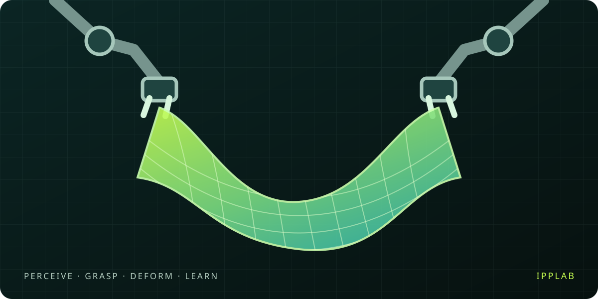

# Awesome Deformable Object Simulation and Manipulation for Embodied AI 🧸 

**A project by IPPLAB**

[Cloth dataset directory / 衣物数据集目录](https://codeofwhite.github.io/awesome-deformable-embodied-ai/datasets/cloth-datasets.html)

> A curated list of resources on deformable object simulation and manipulation (cloth, rope, soft bodies) for embodied intelligence — simulation environments, perception and control, policy learning, sim-to-real transfer, benchmarks, asset generation, and surveys.

[Project website](https://codeofwhite.github.io/awesome-deformable-embodied-ai/) | [English](README.md) | [中文](README.zh-CN.md)

---

## Contents

- [Simulation Environments & Platforms](#simulation-environments--platforms)
- [Deformable Object Manipulation Tasks](#deformable-object-manipulation-tasks)
- [Deformable Object Manipulation Methods](#deformable-object-manipulation-methods)
- [Sim-to-Real Transfer](#sim-to-real-transfer)
- [Benchmarks & Evaluation](#benchmarks--evaluation)
- [3D Asset Generation for Simulation](#3d-asset-generation-for-simulation)
- [Foundational Simulation Techniques](#foundational-simulation-techniques)
- [Surveys & Reading Guides](#surveys--reading-guides)
- [Legend](#legend)

---

## Simulation Environments & Platforms

- **2022-02-01** · [RFUniverse: A Multiphysics Simulation Platform for Embodied AI](https://arxiv.org/abs/2202.00199) · `arXiv:2202.00199` - Multiphysics environment for household robot learning, including soft-body interactions, fluids, airflow, and heat transfer. 📄 🔧
- **2020-03-19** · [SAPIEN: A SimulAted Part-based Interactive ENvironment](https://arxiv.org/abs/2003.08515) · `arXiv:2003.08515` - Interactive simulation environment based on PhysX, excelling at articulated and deformable object simulation. Widely used in Embodied AI research. 📄 🔧 ⭐
- [Genesis World](https://genesis-world.readthedocs.io/) - Multi-physics simulation platform covering rigid, deformable, and fluid bodies. 29k+ GitHub stars. 🔧 ⭐
- [SAPIEN ManiSkill](https://maniskill2.github.io/) - Unified framework for manipulation skill learning built on SAPIEN, with rich deformable object tasks. 🔧 📊 ⭐
- [Isaac Sim / Isaac Lab](https://developer.nvidia.com/isaac-sim) - NVIDIA's robotics simulation platform with GPU-accelerated deformable body support for large-scale Embodied AI training. 🔧 ⭐
- [MuJoCo](https://mujoco.org/) - Advanced physics engine with deformable body simulation support (since v3.x), widely adopted in robotics research. 🔧 ⭐
- [Taichi](https://github.com/taichi-dev/taichi) - High-performance parallel computing language, popular for differentiable soft body simulation in Embodied AI research. 🔧
- **2025-05-14** · [Real2Render2Real: Scaling Robot Data Without Dynamics Simulation or Robot Hardware](https://arxiv.org/abs/2505.09601) · `arXiv:2505.09601` - Scales robot training data via a Real→Render→Real pipeline without dynamics simulation or physical robot hardware. 📄 ⭐

## Deformable Object Manipulation Tasks

- **2025-05-16** · [DexGarmentLab: Dexterous Garment Manipulation Environment with Generalizable Policy](https://arxiv.org/abs/2505.11032) · `arXiv:2505.11032` - Bimanual dexterous garment simulation with structural-correspondence demonstration generation and a hierarchical manipulation policy. 📄 📊
- **2023-03-27** · [DexDeform: Dexterous Deformable Object Manipulation with Human Demonstrations and Differentiable Physics](https://arxiv.org/abs/2304.03223) · `arXiv:2304.03223` - Learns dexterous soft-object skills from human demonstrations and refines planned actions with differentiable physics. 📄
- **2025-03-04** · [GraphGarment: Learning Garment Dynamics for Bimanual Cloth Manipulation Tasks](https://arxiv.org/abs/2503.05817) · `arXiv:2503.05817` - Learns garment dynamics in simulation with graph networks and uses a residual model for real-world bimanual garment hanging. 📄
- **2024-11-02** · [GarmentLab: A Unified Simulation and Benchmark for Garment Manipulation](https://arxiv.org/abs/2411.01200) · `arXiv:2411.01200` - Unified simulation and benchmark for garment manipulation tasks — folding, hanging, dressing. 📄 📊 ⭐
- **2023-08-19** · [ClothesNet: An Information-Rich 3D Garment Model Repository with Simulated Clothes Environment](https://arxiv.org/abs/2308.09987) · `arXiv:2308.09987` - Large-scale 3D garment dataset with rich annotations for manipulation research. 📄 📊
- **2026-03-18** · [RAPID: Rapid Adaptation of Particle Dynamics for Generalized Deformable Object Mobile Manipulation](https://arxiv.org/abs/2603.18246) · `arXiv:2603.18246` - Rapid adaptation of particle dynamics for generalized deformable object mobile manipulation. 📄 ⭐
- **2023-10-14** · [Benchmarking the Sim-to-Real Gap in Cloth Manipulation](https://arxiv.org/abs/2310.09543) · `arXiv:2310.09543` - Systematic evaluation of the sim-to-real gap in cloth manipulation across different simulators. 📄 📊
- **2026-03-26** · [SoftMimicGen: A Data Generation System for Scalable Robot Learning in Deformable Object Manipulation](https://arxiv.org/abs/2603.25725) · `arXiv:2603.25725` - Extends MimicGen to deformable object manipulation, enabling scalable robot demonstration data generation. 📄 ⭐
- **2026-06-24** · [DeformGen: Dynamics-Based Topology Augmentation for Deformable Manipulation Policy Learning](https://arxiv.org/abs/2606.25939) · `arXiv:2606.25939` - Dynamics-based topology augmentation for deformable object manipulation policy learning, built on PhysTwin and Real2Render2Real. 📄

## Deformable Object Manipulation Methods

- **2023-03-24** · [GarmentTracking: Category-Level Garment Pose Tracking](https://arxiv.org/abs/2303.13913) · `arXiv:2303.13913` - Online category-level garment pose tracking from point-cloud sequences, with a simulated folding dataset. 📄 📊
- **2025-01-27** · [BiFold: Bimanual Cloth Folding with Language Guidance](https://arxiv.org/abs/2501.16458) · `arXiv:2501.16458` - Language-conditioned bimanual cloth folding using a vision-language model and an annotated folding dataset. 📄 📊
- **2021-04-07** · [Demonstrating Cloth Folding to Robots: Design and Evaluation of a 2D and a 3D User Interface](https://arxiv.org/abs/2104.02968) · `arXiv:2104.02968` - Compares 2D and augmented-reality interfaces for demonstrating cloth folds with simulated previews. 📄
- **2026-06-02** · [Instant-Fold: In-Context Imitation Learning for Deformable Object Manipulation](https://arxiv.org/abs/2606.04269) · `arXiv:2606.04269` - Single-demonstration in-context folding policy trained in simulation and transferred zero-shot to real robots. 📄
- **2021-05-08** · [FlingBot: The Unreasonable Effectiveness of Dynamic Manipulation for Cloth Unfolding](https://arxiv.org/abs/2105.03655) · `arXiv:2105.03655` - Self-supervised dual-arm cloth unfolding using dynamic pick, stretch, and fling actions, evaluated on real robots. 📄
- **2022-08-22** · [SpeedFolding: Learning Efficient Bimanual Folding of Garments](https://arxiv.org/abs/2208.10552) · `arXiv:2208.10552` - Predicts bimanual action primitives to smooth and fold garments from crumpled initial states on a real robot. 📄
- **2025-09-04** · [Reactive In-Air Clothing Manipulation with Confidence-Aware Dense Correspondence and Visuotactile Affordance](https://arxiv.org/abs/2509.03889) · `arXiv:2509.03889` - Combines confidence-aware visual correspondence and tactile grasp validation for reactive clothing folding and hanging. 📄
- **2020-08-13** · [Cloth Region Segmentation for Robust Grasp Selection](https://arxiv.org/abs/2008.05626) · `arXiv:2008.05626` - Perception and grasping: segments cloth edges and corners from depth images and selects grasp poses, with real-robot grasp evaluation. 📄
- **2024-08-26** · [Center Direction Network for Grasping Point Localization on Cloths](https://arxiv.org/abs/2408.14456) · `arXiv:2408.14456` - Perception and grasping: CeDiRNet-3DoF localizes cloth grasp points and provides the ViCoS Towel Dataset; evaluates perception rather than a complete manipulation pipeline. 📄 📊
- **2022-12-09** · [Visuotactile Affordances for Cloth Manipulation with Local Control](https://arxiv.org/abs/2212.05108) · `arXiv:2212.05108` - Visuotactile control: grasps cloth edges using visual and tactile affordances, then slides along an edge to a corner with tactile feedback. 📄
- **2024-05-11** · [UniGarmentManip: A Unified Framework for Category-Level Garment Manipulation via Dense Visual Correspondence](https://arxiv.org/abs/2405.06903) · `arXiv:2405.06903` - General garment manipulation: learns category-level dense correspondence to guide unfolding, folding, and hanging with one or few demonstrations. 📄
- **2025-07-26** · [CLASP: General-Purpose Clothes Manipulation with Semantic Keypoints](https://arxiv.org/abs/2507.19983) · `arXiv:2507.19983` - General garment manipulation: connects VLM task plans to keypoint-conditioned skills for folding, flattening, hanging, and placing, with dual-arm real-robot evaluation. 📄
- **2022-10-17** · [Cloth Funnels: Canonicalized-Alignment for Multi-Purpose Garment Manipulation](https://arxiv.org/abs/2210.09347) · `arXiv:2210.09347` - Tidying and folding: combines dynamic flings and pick-and-place actions to canonicalize garment configurations before real-world ironing and folding. 📄
- **2025-05-14** · [FoldNet: Learning Generalizable Closed-Loop Policy for Garment Folding via Keypoint-Driven Asset and Demonstration Synthesis](https://arxiv.org/abs/2505.09109) · `arXiv:2505.09109` - Tidying and folding: synthesizes keypoint-annotated garment assets and demonstrations and uses KG-DAgger recovery data for closed-loop folding policies evaluated in simulation and reality. 📄
- **2025-03-12** · [GarmentPile: Point-Level Visual Affordance Guided Retrieval and Adaptation for Cluttered Garments Manipulation](https://arxiv.org/abs/2503.09243) · `arXiv:2503.09243` - Cluttered garments: learns point-level affordances and adapts entangled piles to support garment retrieval, with simulation and real-world evaluation. 📄
- **2026-03-04** · [GarmentPile++: Affordance-Driven Cluttered Garments Retrieval with Vision-Language Reasoning](https://arxiv.org/abs/2603.04158) · `arXiv:2603.04158` - Cluttered garments: combines vision-language reasoning, segmentation, affordances, and dual-arm coordination for language-guided garment retrieval. 📄
- **2024-10-15** · [DeformPAM: Data-Efficient Learning for Long-horizon Deformable Object Manipulation via Preference-based Action Alignment](https://arxiv.org/abs/2410.11584) · `arXiv:2410.11584` - Policy learning: ranks diffusion-generated action candidates using a human-preference reward model for long-horizon real-world deformable manipulation. 📄
- **2026-05-29** · [DeMaVLA: A Vision-Language-Action Foundation Model for Generalizable Deformable Manipulation](https://arxiv.org/abs/2605.31286) · `arXiv:2605.31286` - Policy learning: combines real-world demonstration pretraining, flow-matching actions, and human-in-the-loop corrective data for garment folding across categories. 📄
- **2020-12-06** · [Learning to Rearrange Deformable Cables, Fabrics, and Bags with Goal-Conditioned Transporter Networks](https://arxiv.org/abs/2012.03385) · `arXiv:2012.03385` - Multiple object types: uses image-goal-conditioned Transporter Networks for multi-step cable, fabric, and bag manipulation, evaluated in simulation and physical experiments. 📄
- **2022-03-02** · [DextAIRity: Deformable Manipulation Can be a Breeze](https://arxiv.org/abs/2203.01197) · `arXiv:2203.01197` - Airflow-assisted manipulation: combines grasping and closed-loop blowing actions for cloth unfolding and bag opening on a real three-arm system. 📄
- **2025-03-15** · [Diffusion Dynamics Models with Generative State Estimation for Cloth Manipulation](https://arxiv.org/abs/2503.11999) · `arXiv:2503.11999` - Uses diffusion models to reconstruct cloth states from partial observations and predict dynamics, with model predictive control for real-robot folding. 📄

## Sim-to-Real Transfer

- **2026-07-27** · [Effective Parameters, Real Behavior: Renormalization for Robotics -- From Infinite Electron Mass to Sim-to-Real Gap](https://arxiv.org/abs/2607.24079) · `arXiv:2607.24079` - Brings renormalization from physics to sim-to-real. Simulator parameters take effective, resolution-dependent values. Gives closed-form corrections for PD control, ropes, and underwater swimming. Evidence is analytical, with no new real-robot experiments. 📄
- **2026-06-13** · [SimWeaver: Zero-Shot RGB Sim-to-Real for Deformable Manipulation](https://arxiv.org/abs/2606.15338) · `arXiv:2606.15338` - Combines measurement-backed cloth simulation, topology-aware trajectory synthesis, and photometric augmentation for RGB policy transfer. 📄
- **2026-04-09** · [SIM1: Physics-Aligned Simulator as Zero-Shot Data Scaler in Deformable Worlds](https://arxiv.org/abs/2604.08544) · `arXiv:2604.08544` - Real-to-sim-to-real data generation with scene digitization, calibrated deformable dynamics, and filtered trajectory synthesis. 📄
- **2025-10-29** · [Sim-to-Real Gentle Manipulation of Deformable and Fragile Objects with Stress-Guided Reinforcement Learning](https://arxiv.org/abs/2510.25405) · `arXiv:2510.25405` - Uses stress-penalized rewards and a rigid-to-deformable curriculum to transfer gentle manipulation policies to fragile real objects. 📄
- [Learning to Manipulate Deformable Objects in the Real World via Sim2Real](https://arxiv.org/abs/2512.11070) - End-to-end sim2real pipeline for deformable object manipulation with domain randomization. 📄
- **2023-11-09** · [Differentiable Cloth Parameter Identification and State Estimation in Manipulation](https://arxiv.org/abs/2311.05141) · `arXiv:2311.05141` - Uses differentiable simulation and RGB-D observations to identify cloth physical parameters and estimate cloth states for manipulation. 📄

## Benchmarks & Evaluation

- **2022-10-24** · [DaXBench: Benchmarking Deformable Object Manipulation with Differentiable Physics](https://arxiv.org/abs/2210.13066) · `arXiv:2210.13066` - JAX-based differentiable benchmark covering cloth, rope, and fluids for planning, imitation learning, and reinforcement learning. 📄 📊
- **2025-11-09** · [Real Garment Benchmark (RGBench): A Comprehensive Benchmark for Robotic Garment Manipulation featuring a High-Fidelity Scalable Simulator](https://arxiv.org/abs/2511.06434) · `arXiv:2511.06434` - Combines garment meshes, a cloth simulator, and real-motion measurements to evaluate physical simulation fidelity. 📄 📊
- **2025-07-29** · [MoDeSuite: Robot Learning Task Suite for Benchmarking Mobile Manipulation with Deformable Objects](https://arxiv.org/abs/2507.21796) · `arXiv:2507.21796` - Mobile manipulation task suite for deformable objects, with reinforcement and imitation learning baselines and real-robot transfer experiments. 📄 📊
- **2026-07-05** · [SoftVTBench: A Safety-Aware Visuo-Tactile Benchmark for Physically Constrained Robotic Manipulation of Deformable Objects (Early Version)](https://arxiv.org/abs/2607.04234) · `arXiv:2607.04234` - Early-version visuo-tactile benchmark using FEM deformation states to distinguish task success from physically safe manipulation. 📄 📊
- **2025-11-06** · [Real-to-Sim Robot Policy Evaluation with Gaussian Splatting Simulation of Soft-Body Interactions](https://arxiv.org/abs/2511.04665) · `arXiv:2511.04665` - Reconstructs soft-body digital twins from videos and evaluates robot policies using physics simulation and Gaussian splatting rendering. 📄
- **2024-10-10** · [PokeFlex: A Real-World Dataset of Volumetric Deformable Objects for Robotics](https://arxiv.org/abs/2410.07688) · `arXiv:2410.07688` - Real-world multimodal deformation data with meshes, RGB-D observations, and interaction forces for learning and validating deformable models. 📄 📊
- **2020-11-14** · [SoftGym: Benchmarking Deep Reinforcement Learning for Deformable Object Manipulation](https://arxiv.org/abs/2011.07215) · `arXiv:2011.07215` - Benchmark suite for deformable object manipulation (cloth, rope, fluid) with standardized RL environments. 📄 📊 ⭐

## 3D Asset Generation for Simulation

- **2026-01-24** · [EMPM: Embodied MPM for Modeling and Simulation of Deformable Objects](https://arxiv.org/abs/2601.17251) · `arXiv:2601.17251` - Reconstructs deformable objects from RGB-D videos and identifies material parameters with differentiable MPM and online sensory feedback. 📄
- **2025-11-11** · [NeuSpring: Neural Spring Fields for Reconstruction and Simulation of Deformable Objects from Videos](https://arxiv.org/abs/2511.08310) · `arXiv:2511.08310` - Reconstructs deformable digital twins using piecewise spring topology and neural spring fields for spatially varying physical properties. 📄
- **2026-01-14** · [Image2Garment: Simulation-ready Garment Generation from a Single Image](https://arxiv.org/abs/2601.09658) · `arXiv:2601.09658` - Predicts garment geometry and fabric physics from a single image using material attributes and measured material-to-physics mappings. 📄
- **2025-07-16** · [PhysX-3D: Physical-Grounded 3D Asset Generation](https://arxiv.org/abs/2507.12465) · `arXiv:2507.12465` - End-to-end paradigm for physical-grounded 3D asset generation with PhysXNet dataset. 📄 ⭐
- **2025-11-17** · [PhysX-Anything: Simulation-Ready Physical 3D Assets from Single Image](https://arxiv.org/abs/2511.13648) · `arXiv:2511.13648` - Generate simulation-ready 3D assets with physical properties from a single image. 📄
- **2026-05-20** · [PhysX-Omni: Unified Simulation-Ready Physical 3D Generation for Rigid, Deformable, and Articulated Objects](https://arxiv.org/abs/2605.21572) · `arXiv:2605.21572` - First to include deformable objects in PhysX generation scope, unifying rigid/deformable/articulated. 📄 ⭐
- **2026-07-15** · [DiffGI: Differentiable Geometry Images](https://arxiv.org/abs/2607.13365) · `arXiv:2607.13365` - 3D garment generation via differentiable geometry images (no integrated physics yet). 📄
- **2025-03-23** · [PhysTwin: Physics-Informed Reconstruction and Simulation of Deformable Objects from Videos](https://arxiv.org/abs/2503.17973) · `arXiv:2503.17973` - Physics-informed reconstruction and simulation of deformable objects from video; a precursor to Real2Render2Real and DeformGen. 📄 ⭐
- **2024-09-12** · [Gaussian Garments: Reconstructing Simulation-Ready Clothing with Photorealistic Appearance from Multi-View Video](https://arxiv.org/abs/2409.08189) · `arXiv:2409.08189` - Reconstructs simulation-ready, photorealistic standalone garment assets from multi-view video. 📄

## Foundational Simulation Techniques

- [AgentFEM Morph Lab](https://lab.haoming-luo.com/morph/) - Browser-based planar soft-rod shape design: drag a target or draw a curve to explore distributed actuation with a quasistatic, contact-free mechanical model; not a robot-policy or hardware benchmark. 🔧
- **2021-06-09** · [DiffCloth: Differentiable Cloth Simulation with Dry Frictional Contact](https://arxiv.org/abs/2106.05306) · `arXiv:2106.05306` - Differentiable cloth simulation with dry frictional contact for parameter identification, assisted dressing, and control. 📄 🔧
- **2024-07-10** · [AdaptiGraph: Material-Adaptive Graph-Based Neural Dynamics for Robotic Manipulation](https://arxiv.org/abs/2407.07889) · `arXiv:2407.07889` - Material-conditioned graph dynamics with online physical-property estimation for adapting manipulation to unfamiliar deformable materials. 📄
- **2020-10-07** · [Learning Mesh-Based Simulation with Graph Networks](https://arxiv.org/abs/2010.03409) · `arXiv:2010.03409` - MeshGraphNets learns mesh-based dynamics, including cloth, with adaptive discretization and mesh-space and world-space interactions. 📄
- [XRTailor (OpenXRLab)](https://github.com/openxrlab/xrtailor) - GPU-accelerated cloth simulation engine for large-scale data generation. 🔧
- [Position Based Dynamics (PBD)](https://matthias-research.github.io/pages/tenMinutePhysics/) - Classic introductory resource for Position Based Dynamics simulation. 🔧
- **2024-03-30** · [ThinShellLab: Thin-Shell Object Manipulations With Differentiable Physics Simulations](https://arxiv.org/abs/2404.00451) · `arXiv:2404.00451` - Fully differentiable simulation platform for thin-shell materials (paper, cloth) with varying bending stiffness. 📄 🔧
- [Second-Order FEM for Deformable Surfaces](https://dl.acm.org/doi/10.1145/3592430) - High-order finite element method for improving accuracy in cloth / thin-shell simulation. 📄
- **2025-06-18** · [Particle-Grid Neural Dynamics for Learning Deformable Object Models from RGB-D Videos](https://arxiv.org/abs/2506.15680) · `arXiv:2506.15680` - Learns particle-grid deformable dynamics from sparse-view RGB-D videos and uses the learned models for goal-conditioned manipulation planning. 📄
- **2026-05-27** · [ClothTransformer: Unified Latent-Space Transformers for Scalable Cloth Simulation](https://arxiv.org/abs/2605.27852) · `arXiv:2605.27852` - Models cloth dynamics with latent-space autoregressive Transformers across body-driven garments, robotic manipulation, and free-fall collisions. 📄

## Surveys & Reading Guides

- **2023-12-16** · [A Survey on Robotic Manipulation of Deformable Objects: Recent Advances, Open Challenges and New Frontiers](https://arxiv.org/abs/2312.10419) · `arXiv:2312.10419` - Survey: reviews deformable-object perception, modeling, and manipulation, emphasizing data-driven approaches and open research challenges. 📄
- **2024-07-01** · [Unfolding the Literature: A Review of Robotic Cloth Manipulation](https://arxiv.org/abs/2407.01361) · `arXiv:2407.01361` - Survey: reviews how textile variation is addressed in modeling, perception, benchmarking, and manipulation, and identifies generalization challenges. 📄

---

## Legend

| Tag | Meaning                   |
| --- | ------------------------- |
| 📄  | Paper                     |
| 🔧  | Tool / Framework / Engine |
| 📊  | Benchmark / Dataset       |
| ⭐   | Recommended / Important   |

---

## Contributing

Contributions welcome! Please read the [contribution guidelines](CONTRIBUTING.md) first.

**Quick way to add a paper:**

1. Edit `papers.yml` — add your entry under the appropriate section
2. Run `python generate.py`
3. Submit a Pull Request
